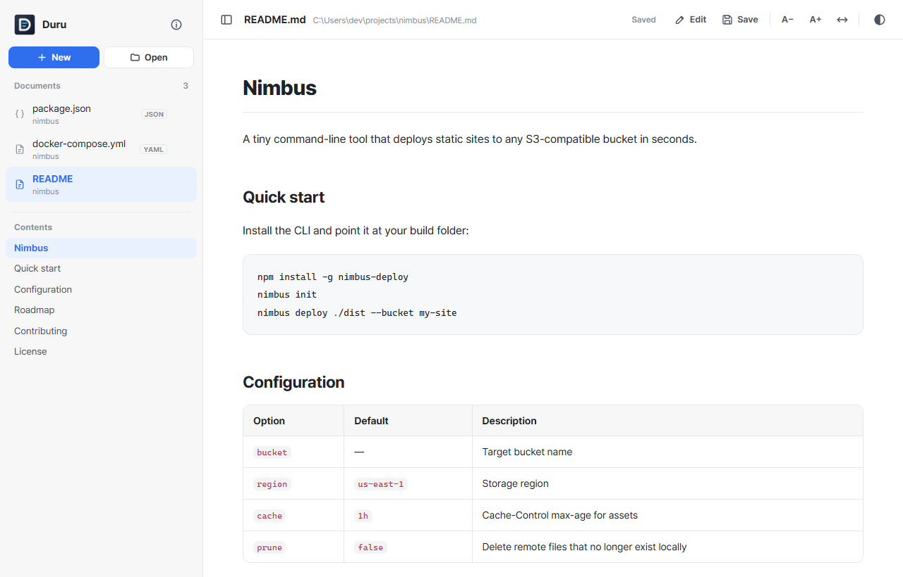
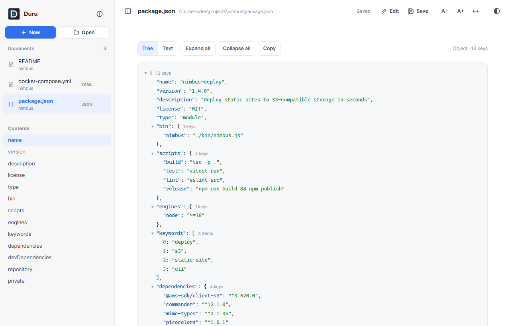
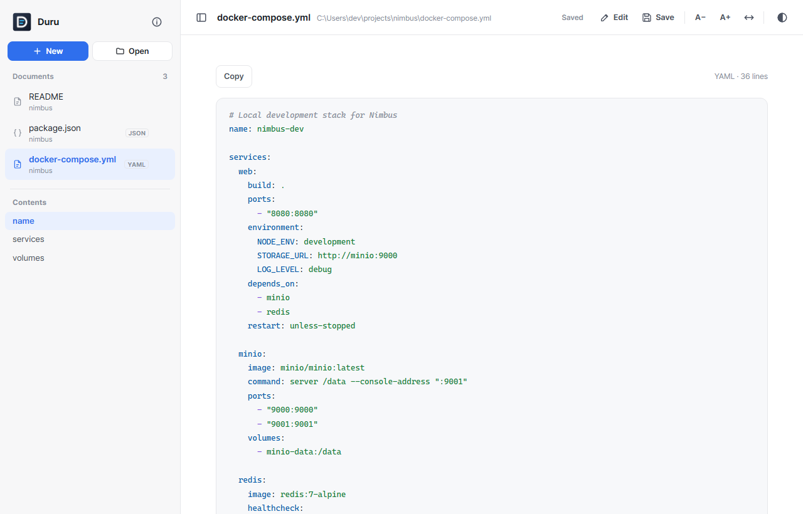
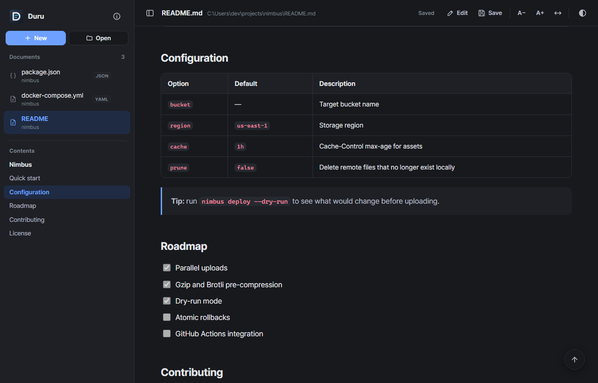

<div align="center">


# Duru

**A tiny, fast Windows app to read and edit Markdown, JSON, YAML and text files.**<br>
Under 3 MB. Opens in a blink. No admin rights. No Electron.

[](https://github.com/git-Harrison/Duru/releases/latest)
[](https://github.com/git-Harrison/Duru/releases)
[](LICENSE)
[](#install)

<br>

<a href="https://github.com/git-Harrison/Duru/releases/latest/download/Duru-Setup.exe"></a>

<sub>Free and open source · Windows 10 / 11 · English, 한국어, 日本語, 简体中文, Español</sub>

<br><br>



</div>

<br>

Double-click a `.md` file and read it as a clean document, with a table of contents, dark mode and code blocks you can copy. Press `Ctrl+E` to edit and `Ctrl+S` to save. Drop in a `package.json` or a `docker-compose.yml` and it just works too.

[한국어](#한국어)

## Screenshots

<table>
  <tr>
    <td width="50%"><br><p align="center"><b>JSON</b> as a collapsible tree</p></td>
    <td width="50%"><br><p align="center"><b>YAML</b> with syntax colors and a key outline</p></td>
  </tr>
  <tr>
    <td colspan="2"><br><p align="center"><b>Dark mode</b>, tables and task lists, with the table of contents following along</p></td>
  </tr>
</table>

## Why Duru?

Most desktop Markdown editors are built on Electron and ship their own copy of a browser engine. They do a lot, and that is great when you need it. Duru is for the many times when you just want to **open a file, read it, fix a line, and close it**.

| | **Duru** | Typical Electron-based editors |
|---|---|---|
| Download size | **Under 3 MB** | Much larger: each app bundles its own Chromium and Node.js |
| Startup | **Fast**: reuses the Microsoft Edge already on your PC | Has to boot its bundled runtime first |
| Install | **No admin rights**, per-user, one click | Varies by app |
| Formats | **Markdown, JSON (tree view), YAML, text** | Usually Markdown only |
| Price / license | **Free, MIT** | Varies (free, freemium or paid) |

Duru is deliberately small. If you need plugins, sync or a WYSIWYG writing experience, a full editor is a better fit. If you want a quick, clean viewer that you never have to wait for, try Duru.

## Features

- **Markdown**: tables, task lists, code blocks with a copy button, images next to the file, and links to other `.md` files that open inside Duru
- **Table of contents** built from your headings, highlighting where you are as you scroll
- **JSON**: collapsible tree view or highlighted text, with expand/collapse all
- **YAML**: syntax colors, with top-level keys listed in the table of contents
- **Text**: shown exactly as written
- **Edit and save**: `Ctrl+E` to switch to editing, `Ctrl+S` to save back to the same file
- **Many documents, one window**: a sidebar to switch between them, and drag & drop to add more
- **Auto-reload** when the file changes on disk, so it works well as a live preview next to your editor
- Hides front matter (`title:`, `tags:` …) at the top of a document
- Dark and light themes, adjustable text size, wide layout
- English, 한국어, 日本語, 简体中文, Español. Follows your Windows language, and you can change it in the ⓘ menu

## Install

1. **[Download Duru-Setup.exe](https://github.com/git-Harrison/Duru/releases/latest/download/Duru-Setup.exe)** (or pick a version on the [Releases](https://github.com/git-Harrison/Duru/releases) page).
2. Run it. No admin rights are needed. Duru installs for your user only.
3. Right-click any `.md`, `.json`, `.yaml` or `.txt` file and choose **Open with Duru**, or drag files onto the window.

> [!NOTE]
> Duru is **not code-signed yet**, so Windows SmartScreen may show a blue "Windows protected your PC" screen. Click **More info → Run anyway**. Release builds are made by [GitHub Actions](.github/workflows/build.yml) from this repository, and each release includes `SHA256SUMS.txt` so you can check the file.

**winget:** coming soon.

**Requirements:** Windows 10 or 11 with Microsoft Edge (installed by default).

To uninstall, go to **Settings → Apps → Installed apps → Duru**.

## Shortcuts

| Key | Action |
|---|---|
| `Ctrl+O` | Open files |
| `Ctrl+E` | Switch between edit and view |
| `Ctrl+S` / `Ctrl+Shift+S` | Save / Save as |
| `Ctrl+B` / `Ctrl+I` | Bold / italic (while editing) |
| `T` | Show or hide the sidebar |
| `D` | Dark / light theme |

## Build from source

You only need Windows. Duru is written in C# and builds with the .NET Framework 4 compiler (`csc.exe`) that already ships with Windows. No SDK, no Node.js, no package manager.

```powershell
git clone https://github.com/git-Harrison/Duru.git
cd Duru
.\build.ps1
```

Output goes to `out\`: `Duru.exe`, `Duru-Setup.exe`, `Duru-Setup.zip` and `SHA256SUMS.txt`.

## Privacy

Duru works entirely on your computer. It does not send your files or any usage data anywhere. It runs a small local server on `localhost` that only Duru's own window can use.

## Contributing

Bug reports, ideas and translations are welcome. Please [open an issue](https://github.com/git-Harrison/Duru/issues). If Duru saves you a few seconds every day, a ⭐ helps other people find it.

## License

[MIT](LICENSE) © git-Harrison

Third-party components:

- [marked](https://github.com/markedjs/marked) (MIT)
- [Pretendard](https://github.com/orioncactus/pretendard) (SIL Open Font License 1.1)

See [THIRD_PARTY_NOTICES.txt](THIRD_PARTY_NOTICES.txt).

---

## 한국어

**Markdown · JSON · YAML · 텍스트 파일을 두루 보고 고치는 가벼운 Windows 앱이에요.** 3 MB가 안 되고, 관리자 권한 없이 설치돼요.

`.md` 파일을 더블클릭하면 목차, 다크 모드, 복사 버튼이 달린 코드 블록과 함께 깔끔한 문서로 보여 줘요. `Ctrl+E`로 편집하고 `Ctrl+S`로 저장해요. JSON은 트리로, YAML은 색을 입혀 보여 줘요.

**설치**
1. **[Duru-Setup.exe 내려받기](https://github.com/git-Harrison/Duru/releases/latest/download/Duru-Setup.exe)**
2. 실행하면 관리자 권한 없이 내 계정에만 설치돼요.
3. 파일을 우클릭해서 **Duru로 보기**를 누르면 돼요.

> 아직 코드 서명이 없어서 "Windows의 PC 보호" 파란 창이 뜰 수 있어요. **추가 정보 → 실행**을 누르세요.

화면 언어는 Windows 언어를 따라가고, 왼쪽 위 ⓘ 메뉴에서 바꿀 수 있어요.
